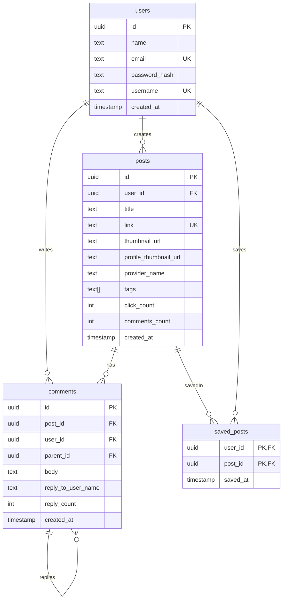
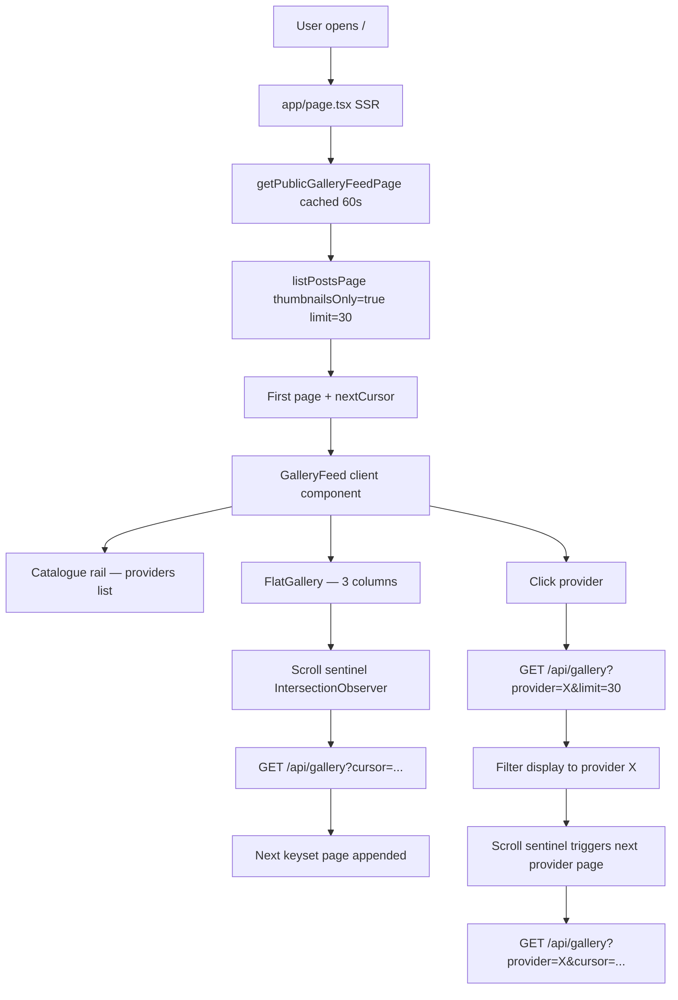
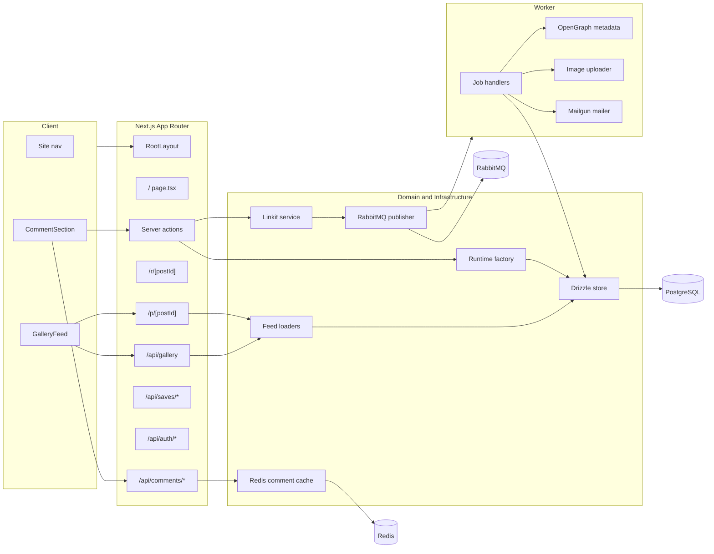

# Linkit — Architecture

## Stack

| Layer | Choice |
|---|---|
| Web framework | Next.js App Router (React + TypeScript) |
| Auth | Auth.js v5, credentials strategy, JWT sessions |
| Database | PostgreSQL via Drizzle ORM |
| Background jobs | RabbitMQ (`amqplib`), dedicated worker container |
| Cache | Redis (top-level comment thread JSON, TTL 60s) |
| Images | Sharp processing, Cloudinary upload, local fallback |
| Email | Mailgun-compatible mailer abstraction |
| Proxy | Caddy (HTTPS termination, HTTP→HTTPS redirect) |
| Tests | Vitest (unit/integration), Playwright (E2E) |
| Dev stack | Docker Compose — caddy, web, worker, postgres, rabbitmq, redis |

Default dev browser URL: `https://localhost:8443` (Caddy HTTPS). Direct Next dev: `npm run dev:web` → `http://localhost:3000`.

---

## Folder Structure

```
app/                    Next.js routes, layouts, server actions
  api/gallery/          Keyset-paginated gallery JSON API
  api/comments/         Comment read/write routes
  api/saves/            Saved-post toggle routes
  api/auth/             Auth.js catch-all handler
  p/[postId]/           Post detail page
  r/[postId]/           Click-count redirect
  settings/             Profile settings page
  signin/               Credentials sign-in
  register/             New account registration
components/             React UI components (client + server)
src/
  auth/                 Auth.js config
  db/                   Drizzle schema + Postgres store
  domain/               Core app types and rules (framework-free)
  feed/                 View model, keyset pagination, feed loaders
  server/               Server-side workflows (posts, register, redis)
  queue/                RabbitMQ job contracts and publisher
  worker/               Background job handlers
  images/               Cloudinary/Sharp uploader
  metadata/             OpenGraph provider
  notifications/        Comment notification builder
scripts/                CLI tools (seed, reseed, migration)
tests/                  Vitest unit/integration + Playwright E2E
```

---

## Key Files to Read First

1. `app/layout.tsx` — global shell and persistent navigation
2. `app/page.tsx` — home page, SSR first gallery page
3. `components/gallery-feed.tsx` — client-side infinite scroll + provider filter
4. `app/api/gallery/route.ts` — keyset-paginated JSON API
5. `app/p/[postId]/page.tsx` — post detail dynamic route
6. `app/r/[postId]/route.ts` — redirect + click counter
7. `src/domain/linkit.ts` — core types and business rules
8. `src/db/linkit-store.ts` — Postgres store implementation
9. `src/feed/load-feed.ts` — feed page builders (global + per-provider)
10. `src/feed/keyset.ts` — cursor encode/decode

---

## Data Model



---

## Gallery Data Flow



### Gallery pagination

Keyset pagination at two levels:

- **Global** (no provider): ordered `(providerName ASC, createdAt DESC, id DESC)`. Cursor encodes all three fields.
- **Per-provider**: ordered `(createdAt DESC, id DESC)` within the provider filter. Cursor still encodes `providerName` but only `createdAt + id` drive the keyset condition.

Provider pages are fetched lazily on first click, then incrementally via scroll. State: `providerCursors: Map<provider, string|null>` — `undefined` = not fetched, `null` = all pages loaded, `string` = next cursor available.

Gallery only shows posts with `thumbnailUrl IS NOT NULL`; unprocessed posts are hidden until enrichment completes.

---

## System Architecture



---

## Submit + Comment Flows

**Submit link:**
1. User posts form → `submitLink` server action
2. Auth check → `createRuntimeServices()`
3. Linkit service deduplicates, creates post, enqueues `link.enrich`
4. If no RabbitMQ: inline OpenGraph fetch + `image.process` no-op
5. `revalidateTag("public-feed")` + `revalidatePath("/")`
6. Redirect `/?posted=1` → `FeedbackBanner` shows toast

**Comment / reply:**
1. `submitComment` server action — `parentId` optional for replies
2. Inserts comment, increments `reply_count` on parent or `comments_count` on post
3. Invalidates `redis:thread:{postId}:top-level`
4. Enqueues `comment.notify` → Mailgun notification to post author + prior commenters

---

## Extension Points

| Feature type | Primary files | Notes |
|---|---|---|
| Gallery UX | `components/gallery-feed.tsx`, `app/globals.css` | Verify empty/loading/mobile states |
| New post field | `src/db/schema.ts`, `src/domain/linkit.ts`, `src/db/linkit-store.ts`, `src/feed/view-model.ts` | Requires migration first |
| Server action | `app/actions.ts`, `src/server/posts.ts`, `src/domain/linkit.ts` | Validate in domain layer, wire redirect + toast |
| Async job | `src/queue/jobs.ts`, `src/worker/handlers.ts` | Add job type, routing key, handler, tests |
| Comment feature | `components/comment-section.tsx`, `app/api/comments/*`, `src/server/redis.ts` | Mind Redis invalidation |
| Auth/account | `auth.ts`, `src/auth/config.ts`, `app/signin/*`, `app/settings/*` | Check anonymous + signed-in nav branches |
| Feed query | `src/feed/load-feed.ts`, `src/feed/keyset.ts`, `src/db/linkit-store.ts` | Keep keyset cursor compatibility explicit |
