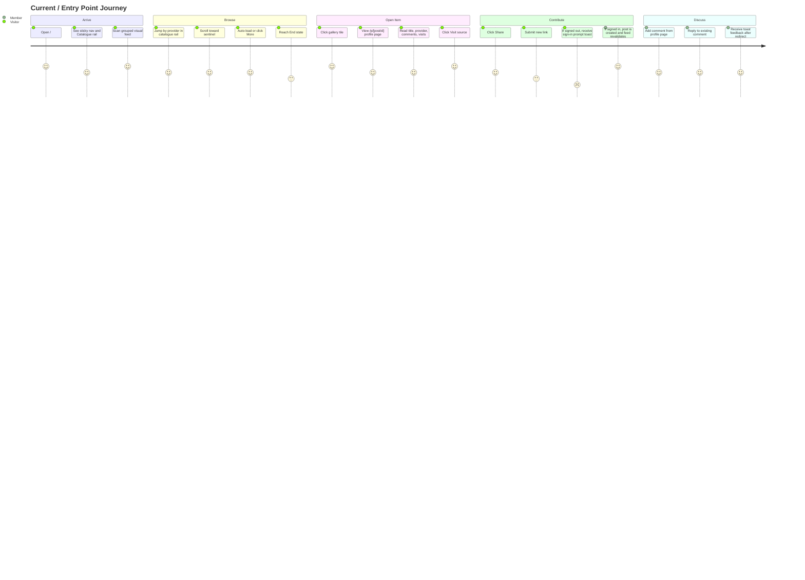
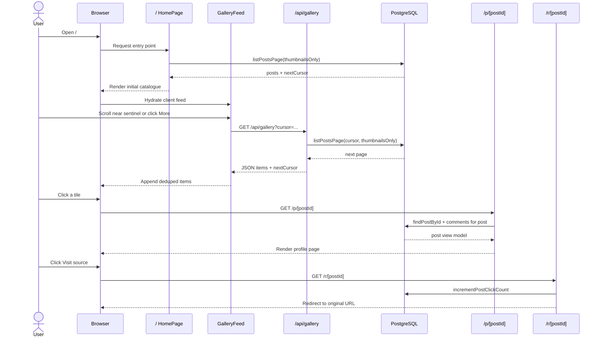
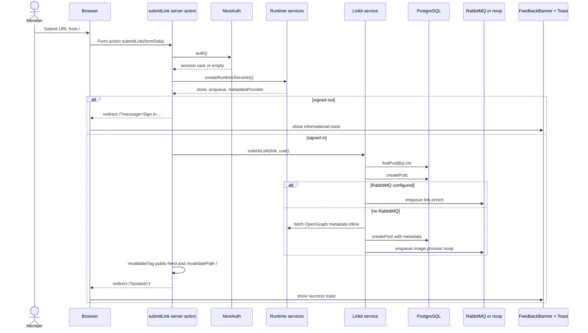
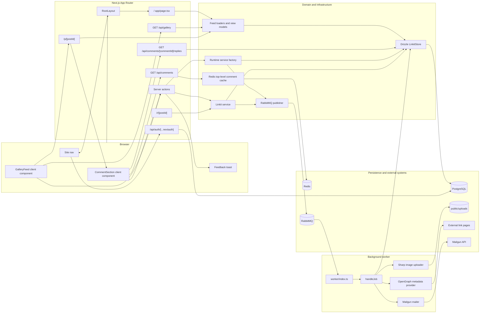
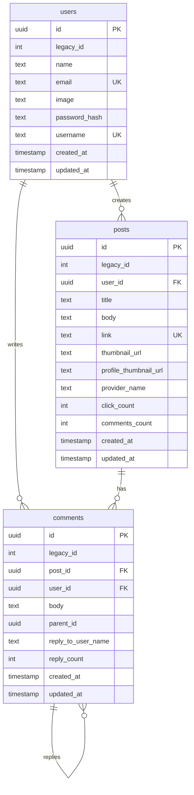
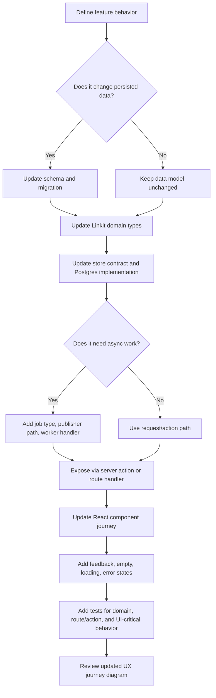

# Current Entry Point UX and Architecture

This document maps the current Linkit entry point at `/` so the journey can be reviewed before adding the next feature.

## Scope

- Entry point: `app/page.tsx`
- Primary surface: public visual catalogue with infinite loading and link submission
- Secondary surfaces reached from entry point: post profile `/p/[postId]`, source redirect `/r/[postId]`, sign-in, settings
- Current stack: Next.js App Router, React client components, server actions, NextAuth, Drizzle, PostgreSQL, Redis, RabbitMQ, worker jobs, Sharp image processing, Mailgun notification delivery

## User Journey



## Entry Point Flow

```mermaid
flowchart TD
  A[User opens /] --> B[RootLayout]
  B --> C[SiteNav checks auth session]
  B --> D[HomePage server component]
  D --> E[getPublicGalleryFeedPage cached for 60s]
  E --> F{DATABASE_URL exists?}
  F -- No --> G[Render empty catalogue]
  F -- Yes --> H[Postgres store lists posts with thumbnails]
  H --> I[Build FeedItem view models]
  I --> J[GalleryFeed client component]
  J --> K[Catalogue rail grouped by provider]
  J --> L[Gallery sections and tiles]
  J --> M[Sentinel / More button]
  M --> N[/api/gallery?cursor=...]
  N --> O[Fetch next keyset page from Postgres]
  O --> P[Append deduped items]
  J --> Q[Submit dock]
  Q --> R[submitLink server action]
  R --> S{Authenticated?}
  S -- No --> T[Redirect /?message=...]
  S -- Yes --> U[Create post through Linkit service]
  U --> V[Revalidate public feed and /]
  V --> W[Redirect /?posted=1]
  T --> X[FeedbackBanner shows toast]
  W --> X
```

## Browse and Detail Flow



## Submit Link Flow



## System Architecture



## Data Model Used by the Entry Point



## Current UX Observations

- The first screen is a catalogue, not a marketing landing page.
- Anonymous visitors can browse, open profiles, visit source links, and attempt to share.
- Signed-in members can share links, comment, reply, update settings, and sign out.
- Link submission feedback is redirect-driven: `/?posted=1` or `/?message=...` is converted to a toast by `FeedbackBanner`.
- The gallery only lists posts with `thumbnailUrl`, so submitted links without thumbnails may not appear in the visual entry feed until enrichment or image processing succeeds.
- Infinite loading has both an IntersectionObserver path and an explicit `More` button fallback.
- Top-level comments are Redis-cached for 60 seconds and invalidated after comment submission.

## Feature Extension Points

Use these hooks when adding a new feature so the change lands in the right layer.

| Feature type | Primary files | System impact |
| --- | --- | --- |
| Entry-point UI behavior | `app/page.tsx`, `components/gallery-feed.tsx`, `components/gallery-tile.tsx`, `app/globals.css` | Changes the public browse/share journey. Verify empty, loading, failed, and mobile states. |
| New post metadata field | `src/db/schema.ts`, `src/domain/linkit.ts`, `src/db/linkit-store.ts`, `src/feed/view-model.ts` | Requires migration, store mapping, and view model update before UI can consume it. |
| New server-side action | `app/actions.ts`, `src/server/posts.ts`, `src/domain/linkit.ts` | Add validation in domain/service layer, then wire redirects and feedback messages. |
| New async job | `src/domain/linkit.ts`, `src/queue/jobs.ts`, `src/worker/handlers.ts`, `src/worker/index.ts` | Add job type, routing key behavior, handler branch, tests, and dead-letter expectations. |
| Comment feature | `components/comment-section.tsx`, `app/api/comments/*`, `src/server/redis.ts`, `src/db/linkit-store.ts` | Consider Redis cache invalidation and reply count consistency. |
| Auth/account feature | `auth.ts`, `src/auth/config.ts`, `app/signin/*`, `app/register/*`, `app/settings/*` | Check anonymous and signed-in nav branches plus session-dependent server actions. |
| Feed query or ranking | `src/feed/load-feed.ts`, `src/feed/keyset.ts`, `src/db/linkit-store.ts` | Keep keyset pagination deterministic and make cursor compatibility explicit. |

## Suggested Next Feature Insertion Pattern



## Review Questions

- Should `/` remain a visual catalogue that filters to posts with thumbnails, or should new text-only submissions appear immediately somewhere?
- Should anonymous users be redirected to `/signin` when they submit, instead of receiving a toast on `/`?
- Should `Visit` on the profile page continue pointing through `/r/[postId]` to count visits, or should external source opening be separated from analytics?
- Should comments load server-side with the profile page for first paint, or stay client-loaded through `/api/comments` for cache flexibility?
- Which next feature should be treated as core journey work versus background enrichment work?
